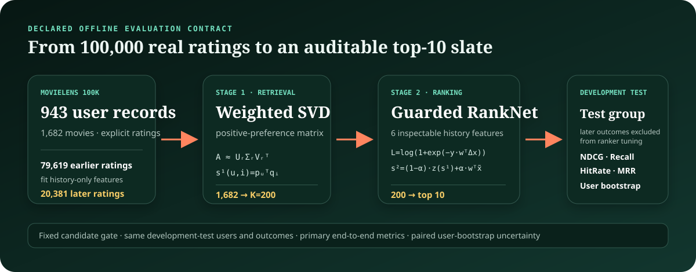

# Two-Stage Movie Recommender: Retrieval + Guarded Learning-to-Rank

An auditable, CPU-only recommendation benchmark on the real [MovieLens 100K](DATA.md) dataset. The project asks a practical model-promotion question:

> If a pairwise ranker learns to order observed ratings, does it also improve the end-to-end top-10 result after the retrieval gate?

In the reference run, the answer is **not established**. Weighted SVD retrieval (latent score plus a small popularity prior) reached `0.1537` NDCG@10; a validation-selected guarded reranker reached `0.1548`, a paired change of `+0.0010` with a 95% percentile user-bootstrap interval of `[-0.0006, +0.0030]`. The unblended RankNet achieved `64.7%` accuracy on sampled development-test pairs, while its primary end-to-end NDCG@10 point estimate was only `0.1172`. That mismatch is the main result: an encouraging auxiliary diagnostic can coexist with a worse primary offline endpoint.



## Review the evidence

- [Benchmark report](REPORT.md) — results, validation choices, candidate-width trade-off, uncertainty, and run provenance
- [Self-contained HTML report](docs/index.html) — browser-friendly version of the same aggregate evidence
- [Machine-readable result](RESULTS.json) — aggregate metrics plus configuration, source-tree, runtime-lock, and local-artifact integrity records
- [Data provenance and terms](DATA.md) — exact source, pinned checksums, citation, and the non-redistribution boundary
- [Mathematics and statistical design](MATH.md) — estimands, models, metrics, and leakage contract
- [Claims and limitations](LIMITATIONS.md) — what this benchmark does and does not support
- [CI workflow](.github/workflows/ci.yml) — tests on Python 3.10/3.12 plus Ruff, pytest, dependency auditing, and source-content checks

## Reference result

The default configuration uses 100,000 ratings from 943 users and 1,682 movies. Each user's ratings are ordered by timestamp, then split into 79,619 earlier history ratings and 20,381 later ratings. Of 885 users eligible for ranking evaluation, 549/159/177 are assigned to disjoint rank-training, validation, and development-test groups. The test results have been inspected during project development, so they are not a pristine confirmatory holdout.

| Method | NDCG@10 | Recall@10 | HitRate@10 | Catalog coverage@10 |
|---|---:|---:|---:|---:|
| Popularity | 0.0744 | 0.0649 | 38.4% | 3.2% |
| Stage 1: weighted SVD + popularity prior | 0.1537 | 0.1365 | 53.1% | 21.5% |
| Stage 2: guarded blend | **0.1548** | **0.1374** | 53.1% | 21.0% |
| Unblended RankNet diagnostic | 0.1172 | 0.0982 | 44.6% | 11.0% |

NDCG, recall, and hit rate are macro-averages over 177 development-test users; catalog coverage is the fraction of all 1,682 movies appearing in their top-10 slates. At candidate width `K=200`, mean per-user candidate recall was 65.9% for later 4- or 5-star movies. For development-test users with at least two later-rated candidates, the report also compares retrieval and the unblended ranker using a secondary, candidate-restricted judged NDCG. That post-hoc diagnostic discards unjudged items, conditions on Stage-1 selection, and has no interval, so it cannot establish a reliable improvement. The unblended ranker's primary end-to-end point estimate was lower, under a metric where unobserved movies remain unjudged but receive zero evaluation gain.

The guarded formula assigns coefficient `0.90` to standardized retrieval affinity and `0.10` to the learned RankNet score. Those coefficients constrain the score mixture; they do not imply that 90% of positions are preserved or that the blend is generally optimal.

These numbers describe reference configuration/data ID `30a640be674a`. They are offline results from one development benchmark and one fixed split, not evidence of live-user or business impact.

## System design

```text
MovieLens ratings for each user
       |
       +-- earlier prefix --> positive-preference matrix --> weighted SVD
       |                                                --> exact top-200 gate
       |
       +-- later suffix  --> observed rating pairs -------------------+
                                                                    |
history-only item/user features --> linear RankNet ------------------+
                                                                    |
validation users --> choose L2 and guarded blend alpha               |
                                                                    v
development-test users --> top-10 evaluation on the fixed candidate gate
```

### Stage 1: inspectable retrieval

Ratings above 2.5 create positive preference mass. All earlier-rated movies, including low-rated ones, remain in the seen mask and are excluded from recommendations. Log weighting, inverse item frequency, row normalization, and a rank-32 randomized SVD produce user/item factors; the latent score also receives a fixed `0.08` standardized popularity prior. The implementation scores all 1,682 movies exactly and retrieves the top 200 unseen candidates with deterministic tie-breaking.

### Stage 2: observed pairwise ranking

The ranker uses six history-derived features: retrieval affinity, genre affinity, Bayesian item mean, log rating count, release-year affinity, and popularity affinity. Training pairs compare later ratings from rank-training users only when both movies passed the Stage-1 gate and differ by at least one star. A linear RankNet/Bradley–Terry objective learns from 19,585 such pairs.

Regularization is chosen by validation pairwise accuracy. A separate validation NDCG@10 check chooses a residual blend from the configuration-declared `alpha in {0, 0.025, 0.05, 0.075, 0.10}` grid. The final score is

```text
score = (1 - alpha) * standardized_retrieval
        + alpha * RankNet_score
```

Development-test users' later outcomes are excluded from ranker fitting and tuning in code. The setup is still transductive and warm-start: every evaluated user contributes their own earlier history to the collaborative model and history-based feature store. [MATH.md](MATH.md) states the boundary precisely.

## Development and auditability

This project is an offline benchmark rather than a live recommendation service. Fixed seeds and deterministic tie-breaking make the configured run repeatable in the pinned environment; exact floating-point identity across operating systems and BLAS implementations is not promised.

The implementation, modeling assumptions, evaluation contract, validation guardrail, tests, and release evidence are kept in the repository so a reviewer can audit each decision. The codebase is deliberately compact enough to trace and modify during an interview.

The most important engineering decisions were:

- treating dataset licensing as a release boundary: explicit acceptance, official HTTPS source, pinned size/checksums, safe extraction, and no raw data in Git;
- separating each user's earlier history from later outcomes and keeping supervised rank-training/validation/development-test user roles disjoint;
- making the candidate gate a first-class metric instead of crediting Stage 2 for items it could never retrieve;
- training only on observed higher-vs-lower rating pairs, without manufacturing negative labels for unobserved movies;
- selecting the bounded residual blend on validation NDCG rather than promoting a model from pairwise accuracy alone;
- reporting the negative-to-neutral end-to-end result and its uncertainty instead of presenting the reranker as an unconditional improvement;
- providing deterministic tie-breaking, seed/config provenance, focused tests, a read-only loopback browser trace, and generated aggregate reports;
- enforcing a fail-closed publication boundary that rejects raw data, generated state, caches, archives, personal paths, common credentials, and unknown files, including reachable Git history.

## License and third-party boundary

Jihuan Aaron Zhang's original project code and documentation are available under the [MIT License](LICENSE). MovieLens data are not included, are not covered by that license, and remain governed by GroupLens's separate terms. See [NOTICE.md](NOTICE.md) and [DATA.md](DATA.md) for the exact boundary.

## Run locally

Python 3.10+ is required. NumPy is the only runtime dependency.

### 1. Create the environment

```bash
python3 -m venv .venv
source .venv/bin/activate
python -m pip install -r requirements-lock.txt
```

### 2. Review and acquire MovieLens once

Read [DATA.md](DATA.md), then explicitly accept the separate GroupLens terms:

```bash
python download_data.py --accept-license
```

The standard-library downloader verifies the official archive and installs it under the ignored `data/` directory. MovieLens data are not part of this repository's MIT license and must not be committed or redistributed.

### 3. Run the complete benchmark with one command

```bash
./run_demo.sh
```

The cross-platform equivalent is `python run_demo.py`. By default, both the local reports and row-level/model artifacts stay under ignored `artifacts/`; a normal local run cannot silently replace the checked public evidence. Use `python run_demo.py --quick` for a smaller smoke run. Quick runs are not comparable to the reference configuration and are rejected if combined with `--publish-reports`.

After a full run on the verified official dataset, a maintainer can explicitly refresh `RESULTS.json`, `REPORT.md`, and `docs/index.html` with:

```bash
python run_demo.py --publish-reports
```

That publication path rejects quick runs, non-reference seeds, and data that do not pass the acquisition manifest and extracted-file integrity checks.

### 4. Inspect a recommendation trace

```bash
python app.py
```

Open <http://127.0.0.1:8012>. The read-only local UI shows the Stage-1 gate, Stage-2 rank movement, held-out judgments when available, and six additive score contributions. It permits loopback binds only, rejects non-loopback `Host` headers, and makes no external browser requests.

## Test and quality checks

```bash
python -m unittest discover -s tests -v
python -m ruff check .
python -m pytest
python public_release.py --check
python public_release.py --check --staged --history
```

The suite covers parsing/split invariants, seen-item exclusion, deterministic candidate nesting, RankNet objective/gradient behavior, additive contributions, ranking metrics, user-bootstrap fixtures, data-download integrity and safe extraction, serialization, and end-to-end candidate-gate integrity. The [CI workflow](.github/workflows/ci.yml) runs the suite on supported Python versions without downloading or redistributing MovieLens. The source-content check is intended for a clean repository and deliberately fails if local `data/`, `artifacts/`, or cache directories are present.

## Repository map

```text
.
├── README.md                     # interviewer-oriented project overview
├── RESULTS.json                  # canonical aggregate result and provenance
├── REPORT.md                     # generated aggregate benchmark report
├── docs/index.html               # generated self-contained HTML report
├── DATA.md                       # source, terms, checksum, and citation
├── NOTICE.md                     # ownership and third-party boundary
├── MATH.md                       # model and evaluation derivations
├── LIMITATIONS.md                # supported and unsupported claims
├── download_data.py              # license-gated, verified acquisition
├── public_release.py              # source, privacy, and history audit
├── run_demo.py / run_demo.sh     # experiment entry points
├── app.py                        # local read-only recommendation trace
├── recsys_lab/
│   ├── data.py                   # parser and per-user chronological split
│   ├── retrieval.py              # weighted randomized SVD and exact top-K
│   ├── ranking.py                # history features and pairwise RankNet
│   ├── evaluation.py             # stage-specific metrics and diagnostics
│   ├── metrics.py                # ranking metrics and paired bootstrap
│   ├── experiment.py             # tuning, orchestration, and provenance
│   └── report.py                 # Markdown/HTML report generator
├── static/index.html             # local trace interface
├── tests/                        # offline unit and integration tests
└── .github/workflows/ci.yml      # public quality gate
```

## Scope

This repository demonstrates statistical reasoning and engineering discipline on a small public benchmark. It does not address new-user/new-item cold start, impression-policy bias, global point-in-time feature joins, fairness, privacy, distributed retrieval, or online experimentation. Exact local timings are descriptive only. See [LIMITATIONS.md](LIMITATIONS.md) before reusing any result or claim.
